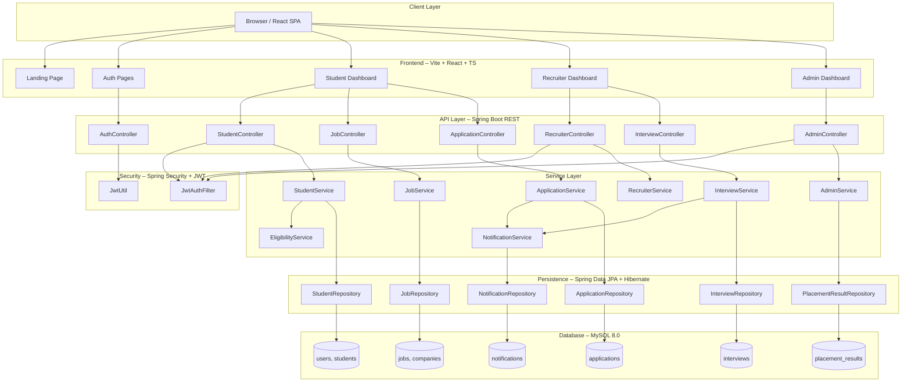

# CampusConnect Architecture

## System Overview



## Layered Architecture

```
┌─────────────────────────────────────────────┐
│              Presentation Layer              │
│         React SPA (Vite + TypeScript)        │
│   Landing │ Auth │ Student │ Recruiter │ Admin│
└─────────────────┬───────────────────────────┘
                  │ HTTP/REST (JSON)
                  │ Authorization: Bearer JWT
┌─────────────────▼───────────────────────────┐
│              Controller Layer                │
│  @RestController + @PreAuthorize (RBAC)      │
│  Request validation + Response wrapping      │
└─────────────────┬───────────────────────────┘
                  │
┌─────────────────▼───────────────────────────┐
│              Service Layer                   │
│  Business logic + Transaction management     │
│  Eligibility Engine + Notification dispatch  │
└─────────────────┬───────────────────────────┘
                  │
┌─────────────────▼───────────────────────────┐
│             Repository Layer                 │
│  Spring Data JPA + Custom JPQL queries       │
│  Pagination + Sorting + Filtering            │
└─────────────────┬───────────────────────────┘
                  │
┌─────────────────▼───────────────────────────┐
│           Database Layer                     │
│  MySQL 8.0 – Normalized relational schema    │
│  12 tables, FK constraints, Indexes          │
└─────────────────────────────────────────────┘
```

## Authentication Flow

```
Client                Spring Boot            Database
  │                       │                     │
  ├─POST /auth/login──────►│                     │
  │  {email, password}    │                     │
  │                       ├─findByEmail(email)──►│
  │                       │◄─User─────────────────┤
  │                       │                     │
  │                       │─BCrypt.matches()─────►│
  │                       │◄─true────────────────►│
  │                       │                     │
  │                       │─generateJWT()─────►  │
  │◄──{token, role}───────┤                     │
  │                       │                     │
  ├─GET /api/student/profile                    │
  │  Authorization: Bearer {token}              │
  │                       │                     │
  │              JwtAuthFilter                  │
  │              validates token                │
  │              sets SecurityContext           │
  │                       │                     │
  │              @PreAuthorize                  │
  │              hasRole('STUDENT')             │
  │◄──{profile data}──────┤                     │
```

## Eligibility Engine

The `EligibilityService` performs multi-criteria eligibility checking:

1. **CGPA Check**: `student.cgpa >= job.minCgpa`
2. **Branch Check**: `student.branch ∈ job.eligibleBranches`
3. **Graduation Year Check**: `student.graduationYear == job.graduationYear`
4. **Skills Check**: `requiredSkills ⊆ student.skills` (comma-separated, case-insensitive)

Response format:
```json
{
  "eligible": false,
  "criteria": [
    { "name": "CGPA", "required": "8.0", "actual": "7.5", "passed": false },
    { "name": "Branch", "required": "CSE, IT", "actual": "CSE", "passed": true },
    { "name": "Graduation Year", "required": "2025", "actual": "2025", "passed": true },
    { "name": "Required Skills", "required": "Java, Algorithms", "actual": "Java, Python", "passed": false }
  ],
  "summary": "Not eligible. Failed: CGPA (7.5 < 8.0), Skills (missing: Algorithms)"
}
```

## Security Architecture

| Mechanism | Implementation |
|---|---|
| Password Hashing | BCrypt with strength 12 |
| Authentication | JWT (HS256, 24h expiry) |
| Authorization | Spring Security + @PreAuthorize |
| Session | Stateless (no server session) |
| SQL Injection | JPA/Hibernate (parameterized queries) |
| File Upload | PDF only, max 5MB, renamed on save |
| CORS | Origin whitelist from config |
| Credentials | Environment variables only |
