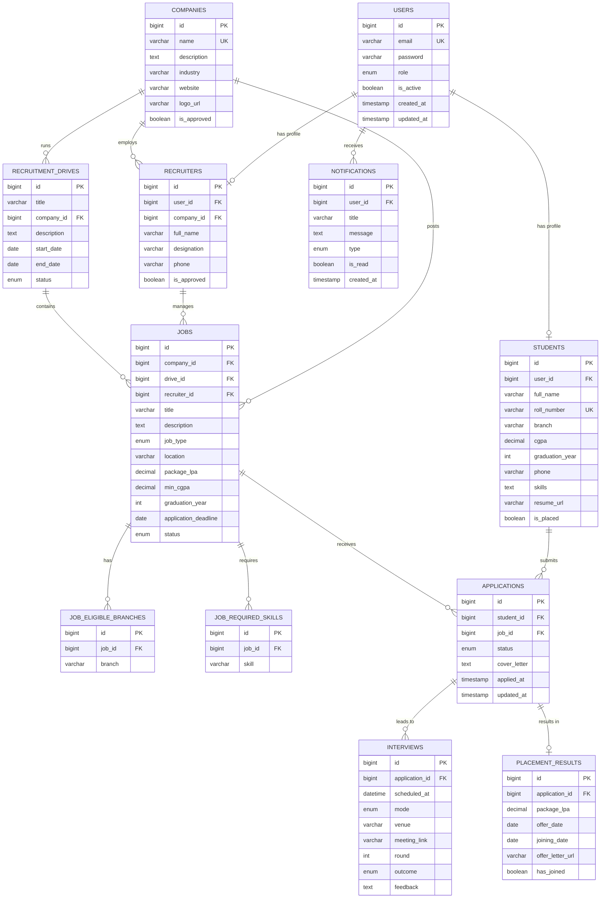

# CampusConnect – Database ER Diagram

## Entity Relationship Diagram

## Table Descriptions

| Table | Purpose |
|---|---|
| `users` | Central authentication table. All roles authenticate through here. |
| `students` | Extended profile for STUDENT users. One-to-one with users. |
| `companies` | Company registry. Must be approved by admin before jobs go live. |
| `recruiters` | Extended profile for RECRUITER users. Linked to one company. |
| `recruitment_drives` | Groups multiple jobs under a campus drive. |
| `jobs` | Individual job postings. Contains eligibility criteria. |
| `job_eligible_branches` | Element collection: which branches can apply to a job. |
| `job_required_skills` | Element collection: which skills are required for a job. |
| `applications` | Student ↔ Job junction with status tracking. |
| `interviews` | Interview schedule for a given application. Supports multiple rounds. |
| `placement_results` | Final outcome of a successful application: offer, package, joining. |
| `notifications` | User inbox for system events (shortlisted, interview scheduled, etc.). |

## Key Constraints

- `users.email` — UNIQUE (prevents duplicate accounts)
- `students.roll_number` — UNIQUE (prevents duplicate student profiles)
- `companies.name` — UNIQUE (prevents duplicate company entries)
- `applications(student_id, job_id)` — UNIQUE (prevents duplicate applications)
- `placement_results.application_id` — UNIQUE (one result per application)
- All FK relationships have appropriate CASCADE/RESTRICT rules
